# FU Cinema Ticket System — Hệ Thống Bán Vé Rạp Chiếu Phim (Web & Desktop)

Hệ thống quản lý và bán vé xem phim toàn diện xây dựng theo kiến trúc **3-Layer + Repository Pattern + Facade Architecture** bằng **Spring Boot, Spring Data JPA & JavaFX 21** cho môn học **HSF302** (Đại học FPT).

---

## 1. Công nghệ sử dụng

- **Ngôn ngữ:** Java 21 LTS
- **Backend Framework:** Spring Boot 3.3 / 4.x
- **Web Client:** Spring MVC, Thymeleaf, Bootstrap 5
- **Desktop Client:** JavaFX 21 (OpenJFX), Virtual Threads (`java.util.concurrent`), FXML & CSS
- **ORM / Persistence:** Spring Data JPA, Hibernate 6
- **Database:** Microsoft SQL Server (`FUCinemaTicketDB`), H2 Database cho Unit / Integration / Facade Test
- **Bảo mật & Phân quyền:** Spring Security Crypto (`BCryptPasswordEncoder`), Session Interceptor (Web), `DesktopSession` + Facade Authorization Defense-in-depth (Desktop)
- **Xử lý bất đồng bộ Desktop:** `FxAsync` dựa trên Executor Virtual Threads của Java 21, kiểm soát an toàn luồng giao diện JavaFX Application Thread
- **Build Tool:** Apache Maven (Maven Wrapper `mvnw`)

---

## 2. Hướng dẫn cài đặt & khởi chạy (Setup Guide)

### Yêu cầu môi trường
- Đã cài đặt **JDK 21 trở lên** (biến môi trường `JAVA_HOME` trỏ tới JDK 21).
- Đã cài đặt **Microsoft SQL Server** (SSMS).

### Bước 1: Khởi tạo Database
Mở SSMS hoặc Azure Data Studio, chạy lệnh:
```sql
CREATE DATABASE FUCinemaTicketDB;
```

### Bước 2: Cấu hình thông tin kết nối cục bộ
Sao chép file cấu hình mẫu sang file cục bộ:
```bash
copy fu-cinema-ticket-system\src\main\resources\application-local.properties.example fu-cinema-ticket-system\src\main\resources\application-local.properties
```
Mở file `application-local.properties` và chỉnh sửa thông tin tài khoản SQL Server của máy bạn:
```properties
spring.datasource.url=jdbc:sqlserver://localhost:1433;databaseName=FUCinemaTicketDB;encrypt=true;trustServerCertificate=true
spring.datasource.username=sa
spring.datasource.password=mat_khau_cua_ban
```

### Bước 3: Khởi chạy song song Web và Desktop
Hệ thống được thiết kế theo kiến trúc **1 repository, 2 entry points**, sử dụng chung database và tầng nghiệp vụ:

#### 🌐 Cách 1: Khởi chạy Web Application (Cổng 8080)
- **Trong IntelliJ / Eclipse:** Chạy file `FuCinemaTicketSystemApplication.java`.
- **Hoặc bằng dòng lệnh:**
  ```bash
  cd fu-cinema-ticket-system
  .\mvnw.cmd spring-boot:run
  ```
- Mở trình duyệt tại: `http://localhost:8080`

#### 🖥️ Cách 2: Khởi chạy Desktop Application (Quầy vé)
- **Trong IntelliJ / Eclipse:** Chạy file `DesktopLauncher.java` (gói `com.fu.cinema.desktop`).
- **Hoặc bằng dòng lệnh:**
  ```bash
  cd fu-cinema-ticket-system
  .\mvnw.cmd compile exec:java -Dexec.mainClass="com.fu.cinema.desktop.DesktopLauncher"
  ```
- *Lưu ý:* Ứng dụng Desktop chạy với profile `desktop`, tắt Tomcat (`WebApplicationType.NONE`) nên có thể chạy đồng thời cùng lúc với Web mà không bị xung đột cổng mạng. Dữ liệu mẫu (DataSeeder) sẽ tự động nạp vào database trong lần chạy đầu tiên.

---

## 3. Danh sách tài khoản thử nghiệm (Test Accounts)

| Vai trò | Email / Username | Mật khẩu | Phạm vi sử dụng | Mục đích kiểm thử |
|---|---|---|---|---|
| **Admin (Nhân viên quầy)** | `admin@fucinema.vn` | `Admin@123` | **Web Admin & Desktop Client** | Đăng nhập quầy vé Desktop, quản lý danh mục (Phim, Suất, Phòng, Đơn), Dashboard KPI, Báo cáo doanh thu & Bán vé tại quầy. |
| **Customer (Hợp lệ)** | `an.nv@gmail.com` | `Customer@123` | **Chỉ Web Client** | Đặt vé online, chọn ghế, xem lịch sử & huỷ vé. *(Bị từ chối khi đăng nhập Desktop theo BR-D1)*. |
| **Customer (Dưới 16 tuổi)** | `binh.tt@gmail.com` | `Customer@123` | **Chỉ Web Client** | Khách hàng 15 tuổi: Kiểm tra ràng buộc độ tuổi xem phim (BR-11) khi đặt vé phim T16/T18. |

---

## 4. Kiến trúc Desktop Client (Assignment 02)

Ứng dụng Desktop được thiết kế tuân thủ nghiêm ngặt các nguyên tắc kiến trúc:
1. **Facade Pattern**: Toàn bộ thao tác nghiệp vụ của UI đều thông qua các lớp Facade (`AuthFacade`, `DashboardFacade`, `GenreFacade`, `MovieFacade`, `RoomFacade`, `ShowtimeFacade`, `CounterSaleFacade`, `BookingFacade`, `ReportFacade`). Tuyệt đối **không inject Repository** vào package `desktop`.
2. **Không rò rỉ Entity lên UI**: Tầng Controller và Component chỉ làm việc với Record và DTO chuyên biệt, tránh hoàn toàn lỗi `LazyInitializationException`.
3. **Mượt mà không đơ lag (Virtual Threads)**: Tất cả các truy vấn Database dài hạn đều thực thi trong `Task` trên nền Virtual Threads thông qua `FxAsync`, cập nhật giao diện an toàn trên JavaFX Application Thread.
4. **Bảo vệ đa lớp (Defense-in-depth)**:
   - **BR-D1**: Ứng dụng Desktop chỉ cho phép tài khoản `ADMIN` đăng nhập. Mọi phương thức ghi trong Facade đều bắt buộc gọi `desktopSession.requireAdmin()`.
   - **BR-D2**: Bán vé tại quầy hỗ trợ tuỳ chọn "Đã thanh toán" (chuyển ngay sang `CONFIRMED`) hoặc chưa thanh toán (`PENDING`).
   - **TC-D16**: Tranh chấp ghế giữa Web và Desktop được bảo vệ an toàn bằng Pessimistic Locking trong database transaction.

---

## 5. Thành viên nhóm & Phân công nhiệm vụ (Nhóm 4 thành viên)

### 5.1. Bảng phân công tổng thể (Cả 2 Assignment)

| STT | Thành viên | Mã sinh viên | GitHub | Vai trò | Phụ trách chính Assignment 01 | Phụ trách chính Assignment 02 |
|:---:|---|:---:|:---:|:---:|---|---|
| 1 | **Dương Trong** | DE190867 | `@duogtrog06tk` | **Team Leader (A)** | Nền tảng, DB, Security Interceptor, Seed, Báo cáo doanh thu (TODO 1–4, 8, 12–15, 26, 32). | Kiến trúc desktop, JavaFX bootstrap, Navigation, Main layout, Admin login & DesktopSession, README & Release v2.0.0 (TODO 33, 34, 36, 46). |
| 2 | **Phạm Minh Đức** | DE190988 | `@ducminh14-cmd` | **Developer (B)** | Domain Nội dung: Thể loại, Phim CRUD, Trang chủ, Review & Bình luận (TODO 18–21, 27, 31). | Shared Utilities (Async, Alert, Validator, Money), Bán vé tại quầy (Counter Sale), Quản lý đơn vé, Báo cáo doanh thu Desktop & Xuất CSV (TODO 35, 43, 44, 45). |
| 3 | **Ngô Viết Bảo Huy** | DE190979 | `@ngo17574-ops` | **Developer (C)** | Domain Khách hàng: Admin quản trị khách, Lịch sử đặt vé, Hồ sơ cá nhân (TODO 16, 17, 29, 30). | Quản lý thể loại, Danh sách phim (tìm kiếm, lọc, phân trang), Dialog Thêm/Sửa/Xoá phim & Bean Validation (TODO 38, 39, 40). |
| 4 | **Nguyễn Lâm Thi** | DE190848 | `@nguyenlamthi` | **Developer (D)** | Domain Vận hành: Phòng chiếu, Suất chiếu, Đơn hàng Admin, Đặt vé trực tuyến (TODO 22–25, 28). | Dashboard & KPI, Quản lý phòng & suất chiếu (chống trùng lịch), Component SeatMapView hiển thị sơ đồ ghế (TODO 37, 41, 42). |

### 5.2. Ma trận Pull Request & Review chéo Assignment 02

| Issue | Tiêu đề Issue / TODO | Người làm | Reviewer chính | Trạng thái PR |
|---|---|---|---|---|
| #42 | `[FEATURE] JavaFX bootstrap & desktop profile (TODO 33)` | Dương Trong (A) | Ngô Viết Bảo Huy (C) | PR #56 — Merged |
| #43 | `[FEATURE] Desktop navigation & main layout (TODO 34)` | Dương Trong (A) | Phạm Minh Đức (B) | PR #57 — Merged |
| #44 | `[FEATURE] Desktop shared utilities (TODO 35)` | Phạm Minh Đức (B) | Nguyễn Lâm Thi (D) | PR #59 — Merged |
| #45 | `[FEATURE] Desktop login & DesktopSession (TODO 36)` | Dương Trong (A) | Nguyễn Lâm Thi (D) | PR #58 — Merged |
| #46 | `[FEATURE] Desktop dashboard with charts (TODO 37)` | Nguyễn Lâm Thi (D) | Dương Trong (A) | PR #64 — Merged |
| #47 | `[FEATURE] Desktop genre management (TODO 38)` | Ngô Viết Bảo Huy (C) | Phạm Minh Đức (B) | PR #60 — Merged |
| #48 | `[FEATURE] Desktop movie list, filter & pagination (TODO 39)` | Ngô Viết Bảo Huy (C) | Nguyễn Lâm Thi (D) | PR #61 — Merged |
| #49 | `[FEATURE] Desktop movie dialog & delete (TODO 40)` | Ngô Viết Bảo Huy (C) | Phạm Minh Đức (B) | PR #62 — Merged |
| #50 | `[FEATURE] Desktop rooms & showtimes (TODO 41)` | Nguyễn Lâm Thi (D) | Ngô Viết Bảo Huy (C) | PR #66 — Merged |
| #51 | `[FEATURE] SeatMapView component (TODO 42)` | Nguyễn Lâm Thi (D) | Dương Trong (A) | PR #67 — Merged |
| #52 | `[FEATURE] Counter sale screen (TODO 43)` | Phạm Minh Đức (B) | Dương Trong (A) | PR #68 — Merged |
| #53 | `[FEATURE] Desktop booking management (TODO 44)` | Phạm Minh Đức (B) | Ngô Viết Bảo Huy (C) | PR #63 — Merged |
| #54 | `[FEATURE] Desktop revenue report & CSV export (TODO 45)` | Phạm Minh Đức (B) | Nguyễn Lâm Thi (D) | PR #65 — Merged |
| #55 | `[DOCS] Desktop README, tests & release v2.0.0 (TODO 46)` | Dương Trong (A) | Ngô Viết Bảo Huy (C) + Nguyễn Lâm Thi (D) | PR #69 — Reviewing |

---

## 6. Kịch bản kiểm thử nghiệm thu Desktop (TC-D01 → TC-D20)

| Mã TC | Kịch bản kiểm thử | Kết quả mong đợi | TODO | Kết quả |
|:---:|---|---|:---:|:---:|
| **TC-D01** | Chạy `DesktopLauncher` | Màn hình đăng nhập mở; log không có Tomcat; website chạy song song bình thường | 33 | ✅ PASS |
| **TC-D02** | Đăng nhập `admin@fucinema.vn` sai mật khẩu | Alert cảnh báo sai thông tin đăng nhập; ô mật khẩu bị xoá | 36 | ✅ PASS |
| **TC-D03** | Đăng nhập `an.nv@gmail.com` / `Customer@123` | Bị từ chối: Báo lỗi chỉ dành cho nhân viên (BR-D1) | 36 | ✅ PASS |
| **TC-D04** | Đăng nhập admin đúng thông tin | Vào màn hình chính, status bar hiện tên; dashboard khớp trang `/admin` | 34, 36, 37 | ✅ PASS |
| **TC-D05** | Web tạo suất chiếu hôm nay → Desktop bấm Làm mới dashboard | Biểu đồ cột tự động cập nhật số liệu mới nhất | 37 | ✅ PASS |
| **TC-D06** | Thêm thể loại "Tài liệu" → sửa → xoá | Thao tác thành công, TableView cập nhật tức thì | 38 | ✅ PASS |
| **TC-D07** | Xoá thể loại "Hành động" (đang có phim gắn liền) | Báo lỗi BR-05, không cho phép xoá | 38 | ✅ PASS |
| **TC-D08** | Lọc phim theo thể loại + trạng thái + từ khoá, chuyển trang | Kết hợp lọc chính xác; đổi tiêu chí tự động về trang 1 | 39 | ✅ PASS |
| **TC-D09** | Thêm phim thời lượng 20 phút (ngoài khoảng [30, 300]) | Dialog không đóng, ô thời lượng viền đỏ và hiển thị tooltip lỗi | 40 | ✅ PASS |
| **TC-D10** | Xoá phim đã có suất chiếu | Thông báo "Đã chuyển STOPPED", dòng trong bảng được tô xám | 40 | ✅ PASS |
| **TC-D11** | Tạo suất chiếu trùng khung giờ cùng phòng | Báo lỗi BR-08, thông báo chỉ rõ suất chiếu bị trùng | 41 | ✅ PASS |
| **TC-D12** | Chọn phim 120 phút, giờ bắt đầu 19:00 | EndTime tự động gợi ý 21:15 (+ 15 phút dọn phòng) | 41 | ✅ PASS |
| **TC-D13** | Bán vé quầy: chọn khách → phim → suất → 3 ghế, tick "Đã thanh toán" | Tổng tiền = 3 × đơn giá; đơn tạo với trạng thái CONFIRMED (BR-D2); sơ đồ ghế cập nhật màu đỏ | 42, 43 | ✅ PASS |
| **TC-D14** | Chọn ghế thứ 9 trên sơ đồ | Không chọn được, hiển thị cảnh báo chỉ được chọn tối đa 8 ghế | 42 | ✅ PASS |
| **TC-D15** | Chọn khách Bình (15 tuổi) mua vé phim T18 | Bị chặn và báo lỗi kiểm tra độ tuổi (BR-11) | 43 | ✅ PASS |
| **TC-D16** | Tranh chấp ghế: Web và Desktop cùng bấm mua 1 ghế gần đồng thời | 1 bên thành công, bên còn lại báo ghế đã bán; DB không bị trùng vé | 43 | ✅ PASS |
| **TC-D17** | Lọc đơn PENDING → Xác nhận; chọn đơn CONFIRMED → Huỷ | Trạng thái chuyển đổi đúng chuẩn BR-13; các nút bấm cập nhật tương ứng | 44 | ✅ PASS |
| **TC-D18** | Chọn đơn đã CANCELLED trong danh sách | Nút Xác nhận và Huỷ tự động bị vô hiệu hoá (disable) | 44 | ✅ PASS |
| **TC-D19** | Chọn khoảng ngày có dữ liệu → Xuất CSV → Mở bằng Excel | File CSV xuất chuẩn UTF-8 BOM, không lỗi font tiếng Việt, số liệu khớp biểu đồ | 45 | ✅ PASS |
| **TC-D20** | Bấm Đăng xuất từ sidebar | Xoá phiên làm việc trong `DesktopSession`, quay về màn hình Login; đóng app kết thúc process | 33, 36 | ✅ PASS |

---

## 7. Ảnh chụp màn hình hệ thống (Screenshots)

### 7.1. Website Khách Hàng & Quản Trị Trực Tuyến
- **Trang chủ & Danh sách phim:**  
  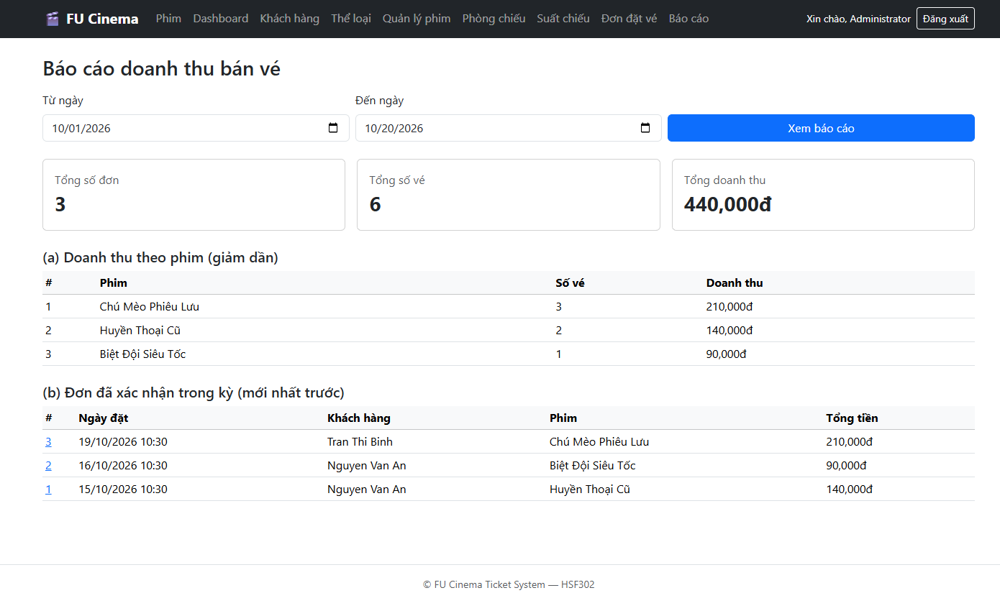
- **Sơ đồ chọn ghế đặt vé trực tuyến:**  
  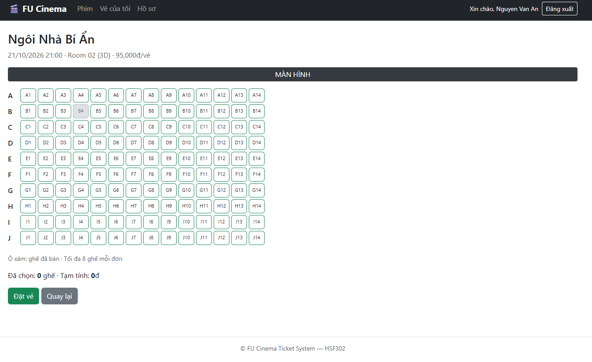
- **Báo cáo doanh thu bán vé:**  
  
- **Dashboard quản trị:**  
  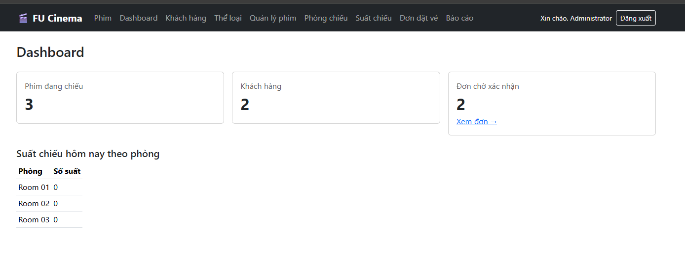

### 7.2. Ứng Dụng Desktop Quầy Vé (JavaFX Client)
- **1. Màn hình đăng nhập (`login.fxml`):**  
  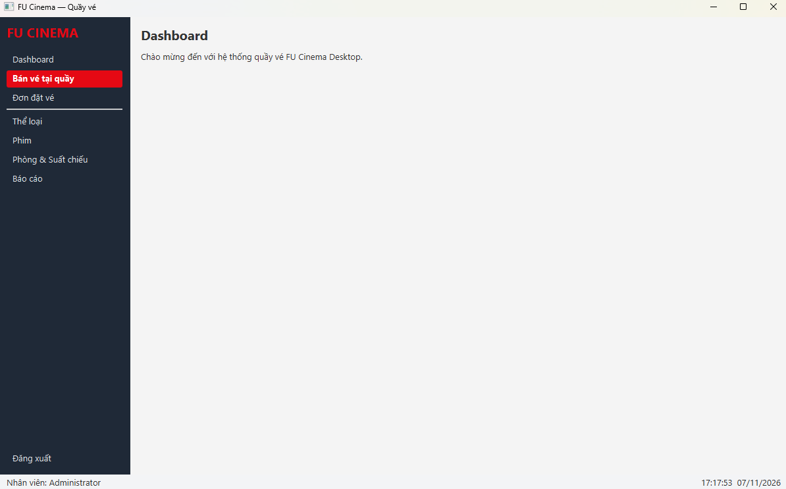
- **2. Dashboard quản trị & Biểu đồ suất chiếu (`dashboard.fxml`):**  
  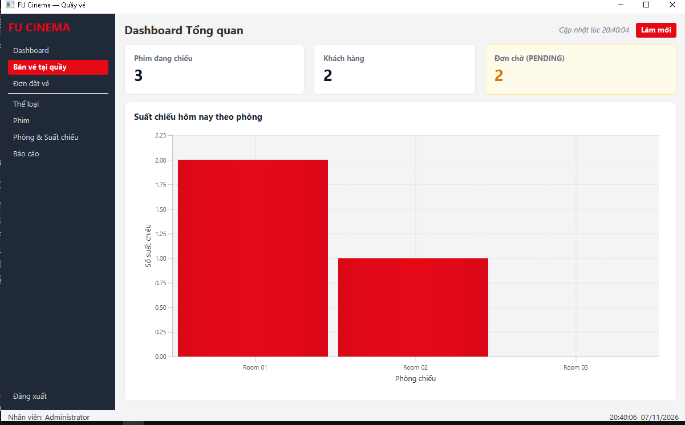
- **3. Quản lý danh mục thể loại (`genre.fxml`):**  
  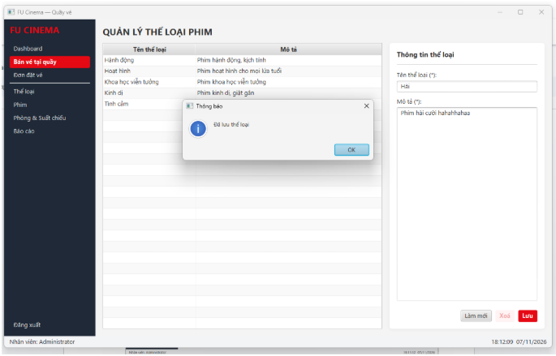
- **4. Danh sách phim & Bộ lọc phân trang (`movie.fxml`):**  
  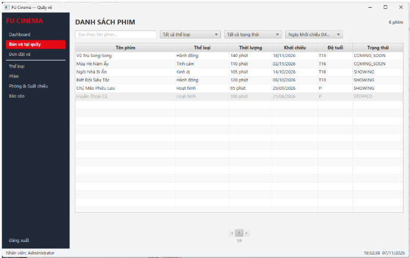
- **5. Dialog thêm & chỉnh sửa phim (`movie-dialog.fxml`):**  
  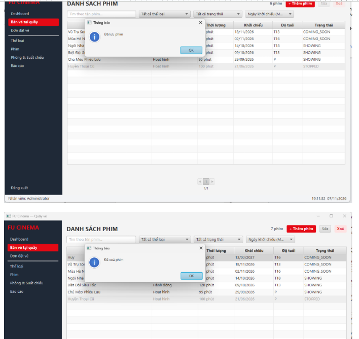
- **6. Quản lý phòng chiếu & Suất chiếu (`schedule.fxml`):**  
  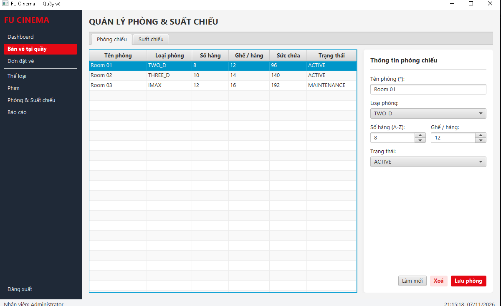
- **7. Component sơ đồ ghế trực quan (`SeatMapView.java`):**  
  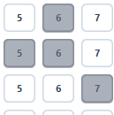
- **8. Màn hình bán vé tại quầy (`counter-sale.fxml`):**  
  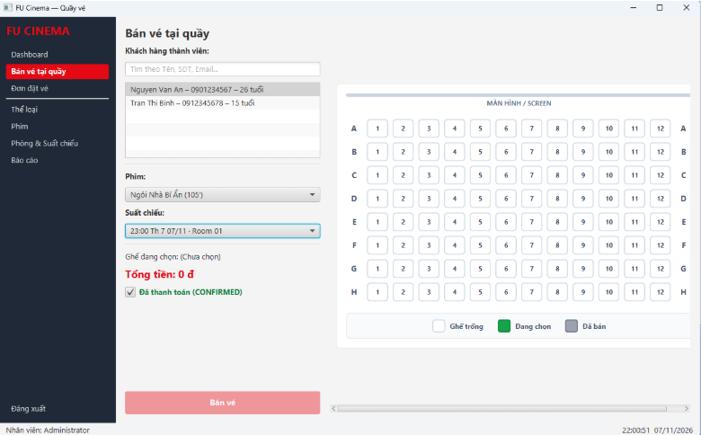
- **9. Quản lý đơn đặt vé & Chuyển đổi trạng thái (`booking.fxml`):**  
  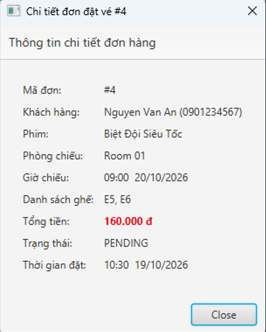
- **10. Báo cáo doanh thu & Xuất file CSV Excel (`report.fxml`):**  
  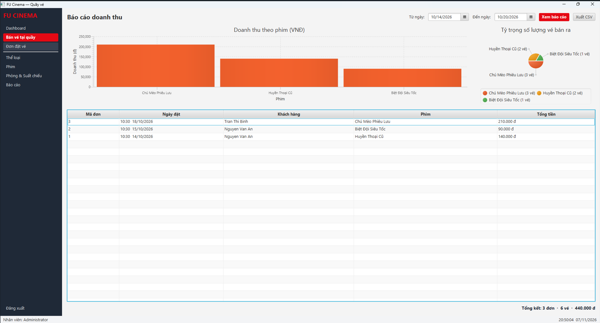

---

## 8. Kết quả kiểm thử tự động (Automated Verification)

Chạy lệnh kiểm thử toàn diện:
```bash
cd fu-cinema-ticket-system
.\mvnw.cmd clean verify
```
**Kết quả:**
- `Tests run: 16, Failures: 0, Errors: 0, Skipped: 0`
- **BUILD SUCCESS**
- Toàn bộ Facade tests (`AuthFacadeTest`, `DashboardFacadeTest`, `GenreFacadeTest`, `ScheduleFacadeTest`, `SeatMapViewTest`) chạy độc lập trên database in-memory H2 với profile `test`.
