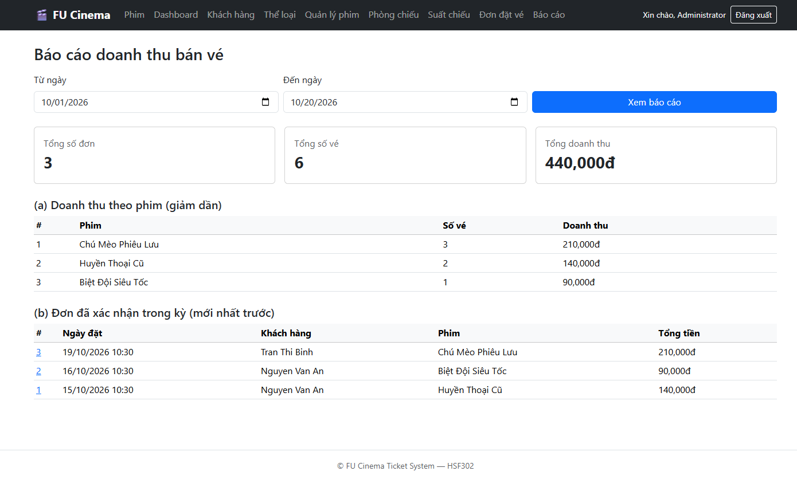
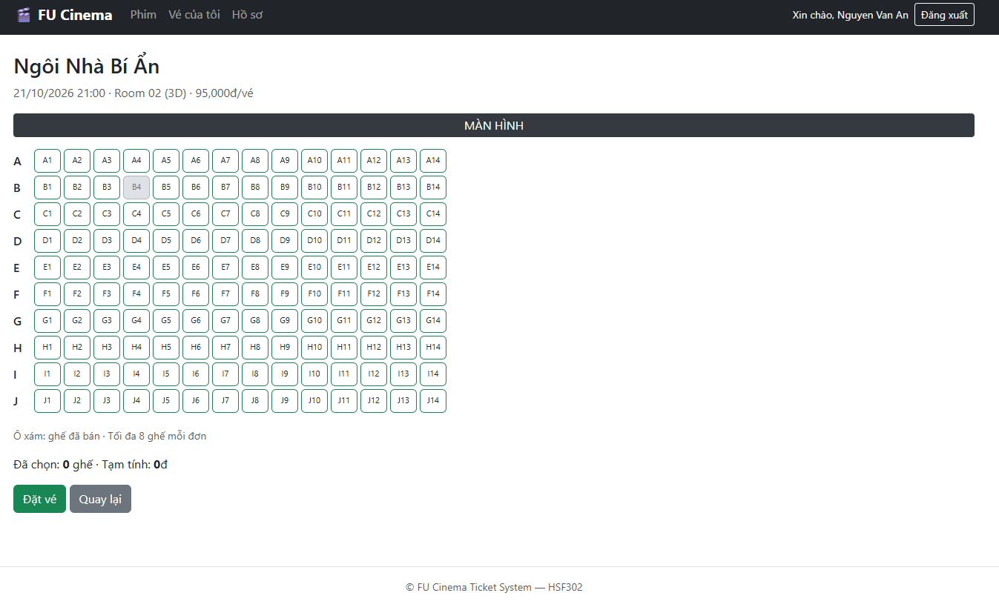
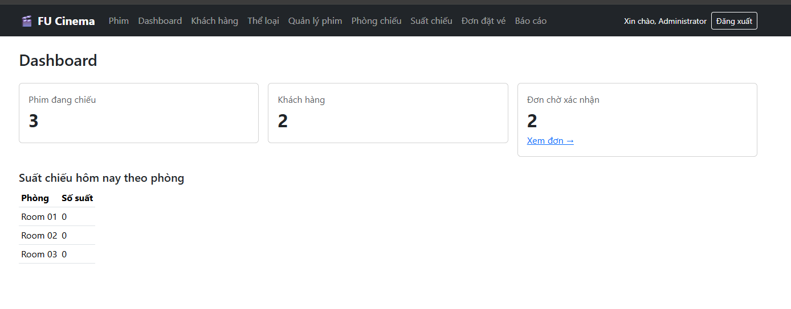

# FU Cinema Ticket System — Website Bán Vé Xem Phim Trực Tuyến

Hệ thống quản lý và bán vé xem phim trực tuyến xây dựng theo kiến trúc **3-Layer + Repository Pattern** bằng **Spring Boot & Spring Data JPA** cho môn học **HSF302**.

## 1. Công nghệ sử dụng
- **Ngôn ngữ:** Java 21+
- **Framework:** Spring Boot 3.3 / 4.x
- **ORM / Persistence:** Spring Data JPA, Hibernate 6
- **Database:** Microsoft SQL Server (`FUCinemaTicketDB`), H2 Database cho Unit Test
- **Template Engine:** Thymeleaf, Bootstrap 5
- **Bảo mật & Mã hoá:** Spring Security Crypto (`BCryptPasswordEncoder`), Interceptor phân quyền theo session
- **Build Tool:** Maven 3.9+ (Maven Wrapper `mvnw`)

## 2. Hướng dẫn cài đặt & khởi chạy (Setup Guide)

### Yêu cầu môi trường
- Đã cài đặt **JDK 21 trở lên** (đã cấu hình biến môi trường `JAVA_HOME`).
- Đã cài đặt **Microsoft SQL Server** (SSMS).

### Các bước khởi chạy:
1. **Tạo Database:**
   Mở SQL Server Management Studio (SSMS) và thực thi lệnh:
   ```sql
   CREATE DATABASE FUCinemaTicketDB;
   ```
2. **Cấu hình thông tin kết nối cục bộ:**
   Copy file mẫu sang file cấu hình thật:
   ```bash
   copy fu-cinema-ticket-system\src\main\resources\application-local.properties.example fu-cinema-ticket-system\src\main\resources\application-local.properties
   ```
   Mở file `application-local.properties` vừa tạo và điền thông tin tài khoản SQL Server của máy bạn:
   ```properties
   spring.datasource.url=jdbc:sqlserver://localhost:1433;databaseName=FUCinemaTicketDB;encrypt=true;trustServerCertificate=true
   spring.datasource.username=sa
   spring.datasource.password=mat_khau_cua_ban
   ```
3. **Khởi chạy ứng dụng:**
   Di chuyển vào thư mục dự án và chạy:
   ```bash
   cd fu-cinema-ticket-system
   .\mvnw.cmd spring-boot:run
   ```
   *(Trên Linux/macOS: `./mvnw spring-boot:run`)*
4. **Truy cập hệ thống:**
   Mở trình duyệt tại: `http://localhost:8080`  
   *Ghi chú:* Khi chạy lần đầu tiên, dữ liệu mẫu sẽ được tự động seed vào database.

## 3. Danh sách tài khoản mẫu (Test Accounts)

| Vai trò | Email / Username | Mật khẩu | Mục đích kiểm thử |
|---|---|---|---|
| **Admin** | `admin@fucinema.vn` | `Admin@123` | Quản trị toàn hệ thống (Phim, Suất chiếu, Phòng, Đơn vé, Báo cáo & Dashboard) |
| **Customer** | `an.nv@gmail.com` | `Customer@123` | Khách hàng hợp lệ: Đặt vé chọn ghế, xem lịch sử đơn, huỷ vé |
| **Customer (15 tuổi)** | `binh.tt@gmail.com` | `Customer@123` | Khách hàng dưới 16 tuổi: Kiểm tra ràng buộc độ tuổi xem phim (BR-11) |

## 4. Thành viên nhóm & Phân công nhiệm vụ (Nhóm 4 thành viên)

| STT | Thành viên | Vai trò | Tỷ lệ đóng góp | Nhiệm vụ & Chức năng phụ trách |
|:---:|---|:---:|:---:|---|
| 1 | **Dương Trong** | Team Leader | 25% | **Nền tảng, Bảo mật & Báo cáo:** Setup project & DB, toàn bộ Entity & Repository khung, Seed data, Đăng nhập / Đăng ký / Phân quyền Interceptor (TODO 1–4, 8, 12–15), Báo cáo doanh thu & Dashboard Admin (TODO 26), Hoàn thiện README & Release (TODO 32). |
| 2 | **Ngô Viết Bảo Huy** | Developer | 25% | **Domain Khách hàng:** Quản trị khách hàng Admin (CRUD, khóa/mở khóa) (TODO 16, 17), Lịch sử & Hủy vé của khách (TODO 29), Quản lý hồ sơ cá nhân & Đổi mật khẩu (TODO 30). |
| 3 | **Phạm Minh Đức** | Developer | 25% | **Domain Nội dung & Phim:** Quản lý thể loại (TODO 18), Quản lý phim & Soft delete (TODO 19–21), Trang chủ & Chi tiết phim (TODO 27), Đánh giá & Bình luận phim (TODO 31). |
| 4 | **Nguyễn Lâm Thi** | Developer | 25% | **Domain Vận hành & Bán vé:** Quản lý phòng chiếu (TODO 22), Quản lý suất chiếu & Chống trùng giờ (TODO 23), Quản trị đơn hàng Admin (TODO 24, 25), Đặt vé trực tuyến chọn ghế (TODO 28). |

## 5. Ảnh chụp màn hình (Screenshots)

- **Trang chủ & Danh sách phim:** 
- **Sơ đồ chọn ghế đặt vé:** 
- **Báo cáo doanh thu bán vé:** 
- **Dashboard quản trị:** 

